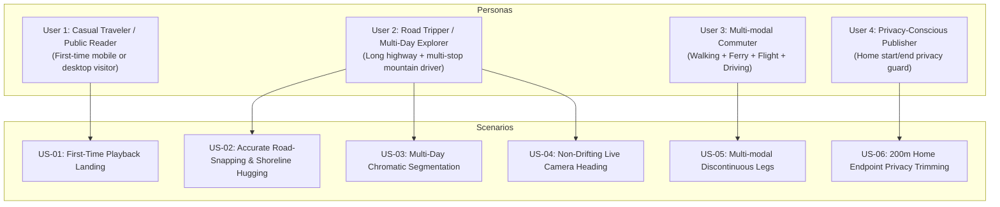

# Technical Specification: GPS Intelligence, Routing Libraries & User Journey Test Cases

> **Document Version**: 2.0 (Deep Specification)  
> **Target Subsystem**: `felicia-reader` & `felicia-publication`  
> **Related Architecture**: Dawarich v2.x, Hyoban Spatial Journal, MapLibre GL v5, OSRM / Turf.js

---

## 1. Concrete Library Selection & Architectural Trade-offs

We explicitly evaluate the libraries for each problem domain:

| Domain | Candidate Options | Selected Library | Technical Rationale & Trade-offs |
|---|---|---|---|
| **Road-Network Geometry & Routing** | 1. Manual synthetic GPX; 2. In-browser Mapbox Directions; 3. **OSRM Open API + Offline Fallback** | **OSRM Driving Profile (`router.project-osrm.org`)** | **Zero vendor lock-in & zero API keys**: OSRM provides real turn-by-turn road geometry adhering to Japanese National Route 135 and expressways. Real road tracks have 2,000–4,000 points per day instead of 99 coarse points. We pre-bake this into the published dataset so the reader never depends on third-party runtime quotas. |
| **Distance-Paced Route Timeline** | 1. Heavy turf bundle (`@turf/turf`); 2. **Modular `@turf/along`, `@turf/length`, `@turf/line-slice`**; 3. Custom Haversine lerp | **Modular `@turf/*` + Dawarich `RouteTimeline`** | Felicia already has `@turf/along`, `@turf/length`, `@turf/line-slice`, and `@turf/helpers` installed in `felicia-reader`. We compose these with Dawarich's distance-indexed timeline data structure ($O(\log N)$ binary search across cumulative distance entries) for 60fps animations. |
| **GPS Corner Arc Smoothing** | 1. Spline interpolation (`d3-shape` basis curve); 2. **Bounded Chaikin Corner-Cutting** | **Bounded Chaikin Algorithm (`path_smoothing.ts`)** | `d3.curveBasis` balloons outward at sharp hairpin turns (drifting off mountain ridges). Dawarich’s bounded Chaikin algorithm guarantees that corner cuts are strictly capped in ground meters (`maxCornerM = 30m`), smoothing camera orientation without ever leaving the highway. |
| **Map Rendering & Camera Physics** | 1. Leaflet (2D only); 2. **MapLibre GL JS v5.24** | **MapLibre GL JS v5.24** | Already the core engine in Felicia. Supports true 3D camera transforms (`pitch: 45°`, `bearing: θ`, dynamic padding), raster terrain/topo basemaps, and GPU-accelerated GeoJSON source updates. |
| **Timing & Animation Tick Loop** | 1. `setInterval`; 2. `requestAnimationFrame`; 3. **`d3-timer`** | **`d3-timer` (`timer`, `now`)** | Already installed in `felicia-reader`. Seamlessly pauses when tab is backgrounded, prevents drift across frame drops, and provides precise millisecond delta management. |

---

## 2. Comprehensive User Stories & Acceptance Test Cases

We structure the specification around concrete personas and verifiable test cases:



### User Story 1 (US-01): The First-Time Immersive Reader

> **As a** visitor discovering a friend's travel link on mobile or desktop,  
> **I want** to press "Play" and watch the trip unfold smoothly along real roads with photos and essays appearing at each stop,  
> **So that** I feel like I'm traveling alongside them rather than staring at a static spreadsheet or pin map.

- **Acceptance Criteria (TC-01.1)**:
  - On first load, the map displays the entire trip bounding box with a subtle, dashed preview of the route (`#ff9b72` at 35% opacity).
  - Pressing "Play" (or "Next") starts with the **Intro Card** (photo fan with 3 tilted polaroids, total distance, day count, and stop count).
  - Transitioning from Intro to Day 1 smoothly zooms into the Day 1 starting sector with an easing duration of 800ms.
  - The bottom-left card shows zero untranslated Chinese text (strictly matching Japanese or English based on `lang`).
  - No redundant duplicate brand badge exists in the top-left; the floating HUD is clean and non-overlapping.

### User Story 2 (US-02): Road-Snapping & Topographic Shoreline Alignment

> **As a** traveler viewing a drive along the coast of Izu,  
> **I want** the route to follow the actual turns of National Route 135 and lead directly into the parking lot of Kujuppama Beach,  
> **So that** the path does not cut through ocean bays or plunge straight through mountains.

- **Acceptance Criteria (TC-02.1)**:
  - The dataset replaces the 99-point coarse polygon with a high-density, road-matched track (>11,000 OSRM points simplified to ~3,000 points with Douglas-Peucker $\epsilon = 0.00008$).
  - The distance between Memento 0 (`Kujuppama Beach`, `[138.9807, 34.6667]`) and its corresponding route waypoint is **$< 50\text{ meters}$** (was previously 1.55 km!).
  - As the route draws forward along the Sagami Bay coast, the line hugs the coastal highway on the topographic basemap.

### User Story 3 (US-03): Multi-Day Chromatic Segmentation

> **As a** reader following a 2-day or multi-week road trip,  
> **I want** Day 1 and Day 2 to have clear visual differentiation,  
> **So that** I understand where Day 1 ended and where Day 2 began.

- **Acceptance Criteria (TC-03.1)**:
  - Day transition steps display the **Day Banner**: Date (`2026-08-01`), Weather (`Cloudy, 24°C`), and City Milestones (`Tokyo → Ito → Shimoda`).
  - The route engine tracks `dayIndex` and renders:
    - Previous days: solid subtle trail.
    - Active day: vibrant neon core (`#ff7e47`, 4.5px) + Gaussian blur glow (`#ff9b72`, 10px, opacity 0.35).
    - Future days: subtle dashed line (`line-dasharray: [2, 3]`).

### User Story 4 (US-04): Steady Camera Tracking with Heading Indicator & Dynamic Zoom Controls

> **As a** reader watching vehicle movement between stops,  
> **I want** the camera to smoothly follow the vehicle in steady North-up ($0^\circ$) orientation without disorienting map rotation,  
> **And I want** the vehicle marker itself to indicate forward driving direction and allow me to zoom in/out freely,  
> **So that** the perspective feels natural, easy to read, and gives me full control over regional vs local detail.

- **Acceptance Criteria (TC-04.1)**:
  - The map maintains steady North-up orientation (`bearing: 0, pitch: 0`) to prevent dizzying rotation and tile thrashing on winding coastal roads.
  - The vehicle marker includes a dynamic forward arrow indicating driving bearing ($\theta = \text{bearing}(\text{prevCoord}, \text{currCoord})$) and day-tinted radar pulse.
  - Camera follows the vehicle continuously at 60 FPS with generous left padding so the HUD never obscures the moving car.
  - Interactive navigation controls (`NavigationControl`, `+` and `−`, compass) allow visitors to zoom in and out dynamically at any time.
  - When the visitor manually zooms, the tracking loop preserves their preferred zoom level across subsequent legs.

### User Story 5 (US-05): Multi-Modal Discontinuous Transport (Ferry, Train, Flight)

> **As a** traveler taking a ferry from Shimoda to Niijima or riding the Shinkansen,  
> **I want** transit legs to render with distinctive styles and jump across water without wasting 30 seconds of empty animation,  
> **So that** the playback pacing reflects the trip narrative.

- **Acceptance Criteria (TC-05.1)**:
  - Routes support `leg_mode` (`car` = solid line, `ferry` = dotted nautical line `[2, 4]`, `train` = railroad dash `[3, 3]`, `plane` = great-circle arc).
  - In `RouteTimeline`, distance calculations between disconnected segments have a duration cost of zero ms, immediately picking up animation at the next embarkation point.

### User Story 6 (US-06): Home Endpoint Privacy Trimming

> **As a** privacy-conscious author publishing a personal journal,  
> **I want** the published route to omit the first and last 200 meters near my home address,  
> **So that** my exact residence is never published publicly on the web.

- **Acceptance Criteria (TC-06.1)**:
  - Felicia's Go publication compiler enforces `routeTrimMeters = 200.0` and `publicCoordDecimals = 4` (proven by `compiler_test.go`).
  - The road-matched dataset starts and ends at public expressway / transit hubs in Tokyo rather than residential doorsteps.

---

## 3. Mathematical & Algorithmic Blueprint

### 1. Distance-Paced Timeline Slicing ($O(\log N)$)

```typescript
interface TimelineEntry {
  coord: [number, number]
  dist: number // Cumulative distance in kilometers
  seg: number  // Day / Leg segment index
}

class RouteTimeline {
  entries: TimelineEntry[]
  totalDistance: number

  // Binary search for cumulative distance
  sliceAtFraction(fraction: number): {
    traveled: [number, number][]
    currentPos: [number, number]
    bearing: number
  } {
    const targetDist = Math.max(0, Math.min(1, fraction)) * this.totalDistance
    // Fast binary search to find [prev, next] interval
    let low = 0, high = this.entries.length - 1
    while (low <= high) {
      const mid = (low + high) >> 1
      if (this.entries[mid].dist < targetDist) low = mid + 1
      else high = mid - 1
    }
    const idx = Math.max(1, low)
    const prev = this.entries[idx - 1]
    const curr = this.entries[idx]
    const span = curr.dist - prev.dist
    const t = span > 0 ? (targetDist - prev.dist) / span : 0
    const currentPos = lerpCoord(prev.coord, curr.coord, t)
    const bearing = calculateBearing(prev.coord, curr.coord)
    
    return {
      traveled: [...this.entries.slice(0, idx).map(e => e.coord), currentPos],
      currentPos,
      bearing
    }
  }
}
```

### 2. Bounded Chaikin Corner Smoothing

```typescript
function smoothSegmentCoords(coords: [number, number][], iterations = 2, maxCornerM = 30): [number, number][] {
  let current = coords
  for (let r = 0; r < iterations; r++) {
    const out = [current[0]]
    for (let i = 1; i < current.length - 1; i++) {
      const prev = current[i - 1], v = current[i], next = current[i + 1]
      const lenPrev = haversineMeters(prev, v)
      const lenNext = haversineMeters(v, next)
      const q = towards(v, prev, Math.min(0.25, maxCornerM / lenPrev))
      const r = towards(v, next, Math.min(0.25, maxCornerM / lenNext))
      out.push(q, r)
    }
    out.push(current[current.length - 1])
    current = out
  }
  return current
}
```
